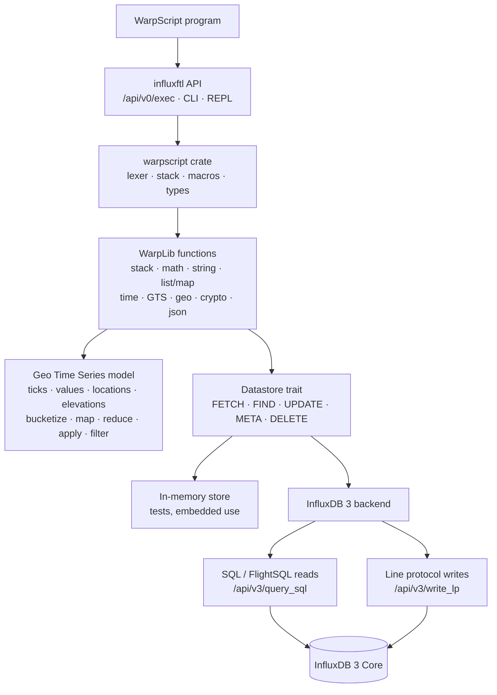

# influxftl — WarpLib / WarpScript for InfluxDB 3

`influxftl` is a Rust port of **WarpLib**, the WarpScript function library of the
[Warp 10 platform](https://github.com/senx/warp10-platform) (Java), running on top of
[InfluxDB 3 Core](https://github.com/influxdata/influxdb) (Rust).

> **Goal in one sentence:** any WarpScript program that worked on Warp 10 should work,
> unchanged, against data stored in InfluxDB 3.

---

## 1. Motivation and goals

Warp 10 is a time series platform made of two independent halves:

| Warp 10 half        | What it does                                                      | What we do with it                          |
|---------------------|-------------------------------------------------------------------|---------------------------------------------|
| **Storage Engine**  | Ingestion, persistence (LevelDB / FoundationDB), tokens, Datalog… | **Not ported.** InfluxDB 3 Core is the store |
| **Analytics Engine**| WarpScript language + **WarpLib** (1300+ functions)               | **Ported to Rust** — this repository        |

We only need the analytics half. InfluxDB 3 Core already provides, in Rust, everything
else: write path, WAL, Parquet persistence, object store, catalog, SQL/InfluxQL query
engine (DataFusion), HTTP API and authentication. Re-implementing a storage engine would
be wasted effort; re-implementing WarpLib is what gives InfluxDB 3 users access to the
richest time series analysis language available.

### Goals

1. **Port WarpLib to Rust.** Every function registered in Warp 10's `WarpScriptLib`
   (1 074 named functions, 149 mapper / reducer / bucketizer / filter / op objects at
   reference revision `b576436`) is in scope. Tracking: [`docs/FUNCTIONS.md`](docs/FUNCTIONS.md).
2. **Behavioural compatibility, not just API compatibility.** Same stack semantics, same
   type coercions, same error conditions, same JSON / text output formats, same
   time-unit conventions (platform time unit = microseconds, as in a default Warp 10).
   Existing WarpScript programs, macros and `WarpFleet` style libraries must run unmodified.
3. **InfluxDB 3 Core is the only datastore.** `FETCH`, `FIND`, `UPDATE`, `META`, `DELETE`
   and friends are implemented against InfluxDB 3 (SQL for reads, line protocol for
   writes). Geo Time Series (GTS) are mapped onto measurements / tags / fields.
4. **Production-grade engineering from day one** (see §5): 100 % test coverage of files,
   lines and regions, security audit of the dependency tree, lints, formatting, formal
   proofs of the critical arithmetic with [Kani](https://model-checking.github.io/kani/),
   reproducible container builds.
5. **Open source, license-compatible with both upstreams** (Apache-2.0, see §8).

### Non-goals

- Porting the Warp 10 storage engine, Datalog replication, Plasma streaming, runner,
  tokens cryptography, HFiles, or the Java plugin / extension loaders.
- Being a drop-in *network* replacement of Warp 10 for every endpoint. We provide the
  `/api/v0/exec` style execution endpoint and a CLI; ingestion goes through InfluxDB 3's
  own `/api/v3/write_lp`.
- Supporting Java-specific WarpScript features (`JAVA` extension, Py4J bridge, `PIGSCHEMA`,
  class-loader based `EXT` loading). These functions exist in the registry but raise a
  clear "not supported on this platform" error.

---

## 2. Architecture



### Crates

| Crate                 | Path                 | Role                                                                 |
|-----------------------|----------------------|----------------------------------------------------------------------|
| `warpscript`          | `crates/warpscript`  | The language runtime and WarpLib. **Storage agnostic**, no I/O.      |
| `influxftl`           | `crates/influxftl`   | Binary: CLI / HTTP execution endpoint + InfluxDB 3 datastore backend. |
| `xtask`               | `xtask`              | Developer automation (`cargo xtask …`), see §5.                      |

The split mirrors Warp 10 itself, where the Analytics Engine can be used without the
Storage Engine: `warpscript` can be embedded in any Rust program with a custom
`Datastore` implementation.

### Compatibility contract

The reference implementation is Warp 10 at git revision
`b5764364679f6ccc40a23632e352d134fab1c2eb` (`master`, 2025). The relevant Java sources
are vendored read-only under `reference/` (git-ignored) to make side-by-side porting and
auditing easy. For every ported function we keep:

- the **stack signature** (what is consumed, what is produced, in which order);
- the **type coercion rules** (`LONG`/`DOUBLE` promotion, Java wrapping arithmetic on
  `LONG`, string concatenation with `+`, `NaN` handling…);
- the **error messages** where scripts could depend on them (`TRY`/`ERROR`);
- the **textual formats** (`SNAPSHOT`, `->JSON`, `TOSTRING`, GTS text format, ISO 8601).

Known, documented divergences live in [`docs/DIVERGENCES.md`](docs/DIVERGENCES.md).

### Mapping Warp 10 concepts onto InfluxDB 3

| Warp 10                         | InfluxDB 3 Core                                                        |
|---------------------------------|------------------------------------------------------------------------|
| GTS **class name**              | measurement (table)                                                    |
| GTS **labels**                  | tags                                                                   |
| GTS **attributes**              | tags prefixed `_attr_` (attributes are mutable metadata in Warp 10)   |
| **value** (LONG/DOUBLE/BOOLEAN/STRING) | field `value` (typed columns `value_l`, `value_d`, `value_b`, `value_s`) |
| **location** (HHCode / lat,lon) | fields `lat`, `lon` (HHCode recomputed on read)                        |
| **elevation**                   | field `elev`                                                           |
| **tick** (µs by default)        | `time` column (ns), converted at the datastore boundary                |
| read token / write token        | InfluxDB 3 token (`Authorization: Bearer …`)                           |
| `FETCH` selector `class{labels}`| `SELECT … FROM measurement WHERE tag = … AND time …`                   |
| `UPDATE` / GTS input format     | line protocol                                                          |

---

## 3. Repository layout

```
.
├── Cargo.toml                 # workspace
├── rust-toolchain.toml        # pinned stable toolchain
├── deny.toml                  # cargo-deny policy (licenses, advisories, sources, bans)
├── Dockerfile                 # OCI build, Docker / Podman / Buildah compatible
├── crates/
│   ├── warpscript/            # language runtime + WarpLib (library)
│   └── influxftl/             # CLI / server binary + InfluxDB 3 backend
├── xtask/                     # `cargo xtask` developer automation
├── docs/
│   ├── FUNCTIONS.md           # port status of every WarpLib function
│   ├── DIVERGENCES.md         # documented behavioural differences
│   └── RUST_RULES.md          # coding rules: no unsafe, typed errors, NaN policy
├── reference/                 # git-ignored sparse checkout of Warp 10 (Java) for porting
├── LICENSE                    # Apache-2.0
└── NOTICE                     # attribution
```

---

## 4. Getting started

```sh
# run a script from a file (platform time unit: microseconds, like Warp 10)
cargo run -p influxftl -- run examples/hello.mc2

# evaluate a one-liner, print the stack as JSON, top first (like /api/v0/exec)
cargo run -p influxftl -- eval "1 2 + 'hello' 3 ->LIST"

# serve the execution endpoint
cargo run -p influxftl -- serve --listen 127.0.0.1:8080
curl --data-binary "40 2 +" http://127.0.0.1:8080/api/v0/exec      # [42]
```

`POST /api/v0/exec` answers the stack as JSON (top first) with `X-Warp10-Elapsed` and
`X-Warp10-Ops`; a failing script gets a `500` with `X-Warp10-Error-Line` and
`X-Warp10-Error-Message`, like Warp 10's endpoint. The datastore functions (`FETCH`, `FIND`,
`UPDATE`, `META`, `DELETE`…) work on a datastore the host connects: the InfluxDB 3 one is the next
step, and `INFLUXFTL_DATASTORE=memory` connects one in memory (see `docs/DATASTORE.md`).

Embedding the engine:

```rust
use warpscript::{Stack, Value};

let mut stack = Stack::new();
stack.exec("1 2 +")?;
assert_eq!(stack.peek()?, &Value::Long(3));
# Ok::<(), warpscript::Error>(())
```

---

## 5. Quality gates (`cargo xtask`)

All gates are driven by the `xtask` crate so that they run identically on a developer
laptop, inside the container and in CI. **There is no git hook**: run the chain yourself
before you consider work done.

| Command                      | What it does                                                                                 |
|------------------------------|----------------------------------------------------------------------------------------------|
| `cargo xtask security-audit` | `cargo deny check` (licenses, advisories, bans, sources) **and** `cargo audit` (RustSec DB) |
| `cargo xtask check`          | `cargo check --workspace --all-targets --locked`                                             |
| `cargo xtask fmt`            | `cargo fmt --all --check`                                                                    |
| `cargo xtask clippy`         | `cargo clippy --workspace --all-targets -- -D warnings`                                      |
| `cargo xtask test`           | `cargo test --workspace`                                                                     |
| `cargo xtask coverage`       | `cargo llvm-cov` and **fails unless every file is at 100 % lines, 100 % regions and 100 % functions** |
| `cargo xtask proof`          | `cargo kani` — runs all Kani proof harnesses                                                 |
| `cargo xtask dev-check`      | The full pre-push chain: **security-audit → check → fmt → clippy → test → coverage → proof** |
| `cargo xtask functions`      | Regenerates `docs/FUNCTIONS.md` from the function registry and the reference inventory      |

### Coverage policy: 100 % of files, lines and regions

- Measured with `cargo llvm-cov` (LLVM source-based coverage: regions, lines, functions).
- Scope: every `.rs` file of `crates/*/src` that defines a function (a file that only declares
  types, such as the enums of the typed errors whose `Display` is derived by `thiserror`,
  holds no code the instrumentation can count). Test code is kept in dedicated files
  (`…/tests.rs`, `tests/` directories) which are excluded from the measurement, so that
  the `assert!` failure branches of the tests themselves do not pollute the figures.
  `xtask` is excluded as well: it is the tool that produces the gate.
- Consequences for how code is written: no unreachable defensive branches, no
  un-exercised `#[derive]`s, every `?` error path has a test, every function has a test.
  This is deliberate: a 1 000+ function port is only trustworthy if every path is executed.

### Formal proofs (Kani)

Pure, security- or correctness-critical helpers (tick/bucket arithmetic, overflow-free
time conversions, HHCode geo encoding, varint, percent-decoding, tokenizer invariants…)
carry `#[kani::proof]` harnesses that prove absence of panics and key algebraic
properties for all inputs within bounds. `cargo xtask proof` runs them all.

### Security audit

`deny.toml` allows only OSI licenses compatible with Apache-2.0 (Apache-2.0, MIT, BSD,
ISC, Unicode, Zlib…), denies yanked crates and known advisories, and restricts sources
to crates.io. `cargo audit` double-checks `Cargo.lock` against the RustSec database.

---

## 6. Building with Docker / Podman / Buildah

The `Dockerfile` is plain OCI (no BuildKit-only syntax, fully-qualified image names) so it
builds with any of:

```sh
docker build -t influxftl .
podman build -t influxftl .
buildah build -t influxftl .
```

Stages:

- `builder` — official `rust` image, `cargo build --release --locked`;
- `runtime` — minimal Debian image with the `influxftl` binary (default target);
- `dev` — builder plus `cargo-deny`, `cargo-audit`, `cargo-llvm-cov`, `kani`, used to run
  the complete `cargo xtask dev-check` on any machine:
  `podman build --target dev -t influxftl-dev . && podman run --rm influxftl-dev`.

Build arguments: `RUST_VERSION` (default from `rust-toolchain.toml`), `DEBIAN_VERSION`.

---

## 7. Development workflow

- Code follows [`docs/RUST_RULES.md`](docs/RUST_RULES.md): no `unsafe`, no `unwrap()` in library
  code, typed `thiserror` errors propagated with `?`, no swallowed errors, NaN/Infinity refused
  at the edges. This is a Rust port, not a transliteration of the Java.
- Work is committed **locally and iteratively**; nothing is pushed automatically.
  Each commit must leave `cargo xtask dev-check` green.
- Long-running commands (`dev-check`, coverage, Kani) are best launched detached from the
  editor or terminal session, e.g. `setsid nohup cargo xtask dev-check > /tmp/devcheck.log 2>&1 &`,
  so that closing the editor never kills them.
- Porting a function: read the Java source under `reference/`, add the Rust implementation
  in the matching `crates/warpscript/src/functions/<group>/` module, register it, add
  script-level tests (`assert_script!`) covering every branch, update `docs/FUNCTIONS.md`
  with `cargo xtask functions`.
- Milestones:
  1. runtime core: lexer, stack, macros, control flow, symbols, errors, limits;
  2. scalar WarpLib: stack, arithmetic, math, strings, lists, maps, sets, JSON, time;
  3. GTS model + frameworks: `BUCKETIZE`, `MAP`, `REDUCE`, `APPLY`, `FILTER`, `FILL`;
  4. mappers / reducers / bucketizers / filters / ops / fillers;
  5. datastore functions on InfluxDB 3: `FETCH`, `FIND`, `UPDATE`, `META`, `DELETE`;
  6. geo (HHCode, GeoXP shapes), encoders, crypto, compression, formats (`SNAPSHOT`, `WRAP`);
  7. HTTP execution endpoint, `TIMEBOX`, limits, capabilities;
  8. long tail of the registry until `docs/FUNCTIONS.md` is all green.

---

## 8. License

`influxftl` is licensed under the **Apache License, Version 2.0** — see [`LICENSE`](LICENSE)
and [`NOTICE`](NOTICE).

Apache-2.0 was chosen because it is the license of Warp 10 (the code being ported) and
one of the two licenses of InfluxDB 3 Core (MIT **or** Apache-2.0, at the user's choosing),
so the project is compatible with both upstreams in both directions: Warp 10 code may be
ported here and this code could be contributed back to either project.

### Licensing of derived code

The repository is a derivative work in the sense of the Apache License, and it follows the
obligations of its section 4:

- every source file carries a header stating what it derives from (`// Derived from Warp 10
  (Copyright 2018-2026 SenX S.A.S., Apache-2.0), ported to Rust and modified.`), which is
  the "prominent notice of modification" the license asks for;
- [`NOTICE`](NOTICE) reproduces the attribution notices of the upstream `NOTICE` files that
  pertain to this product and carries the full copyright / permission notices of the
  permissively licensed works;
- the original copyright notices are kept in those headers and in `NOTICE`.

| Work | License | Use in `influxftl` |
|---|---|---|
| [Warp 10](https://github.com/senx/warp10-platform) (SenX S.A.S.) | Apache-2.0 | WarpLib ported to Rust: names, semantics, algorithms, error messages |
| [GeoXP](https://github.com/senx/geoxplib) (SenX S.A.S.) | Apache-2.0 | HHCode geo-indexing scheme |
| [InfluxDB 3 Core](https://github.com/influxdata/influxdb) (InfluxData) | MIT or Apache-2.0 | **Runtime dependency only** — no InfluxDB source code is included; it is used through its HTTP API |
| [mustache.java 0.9.6](https://github.com/spullara/mustache.java) (RightTime, Inc.) | Apache-2.0 | `TEMPLATE` (template compiler and renderer) |
| [Apache Commons Math 3.6.1](https://commons.apache.org/math/) (ASF) | Apache-2.0 | numerical routines of `cmath.rs`, interpolators of `interpolation.rs`, Levenberg-Marquardt polynomial fitting of `curvefit.rs` |
| [Bouncy Castle](https://www.bouncycastle.org) (Legion of the Bouncy Castle) | MIT-style | Argon2 engine of `ARGON2` |
| [fdlibm](https://www.netlib.org/fdlibm/) (Sun Microsystems) | permissive Sun notice | `IEEEREMAINDER` algorithm |

Java behaviour that scripts can observe (`java.lang.Math`, `java.util.Random`,
`java.util.Formatter`, `Double.toString`, Joda-Time, Jackson, Guava…) is **re-implemented
from the public specifications and validated black-box against the JDK**; OpenJDK is
GPLv2 with the Classpath exception, which is not compatible with redistribution under
Apache-2.0, so no OpenJDK code is transliterated. `docs/PORTING.md` §8 states these rules
for contributors.

Dependencies are policed by `deny.toml`: only OSI licenses compatible with Apache-2.0 are
allowed (`cargo deny check licenses` is part of `cargo xtask dev-check`).

### Trademarks

*Warp 10, WarpScript, WarpLib, WarpFleet, Geo Time Series and SenX* are trademarks of SenX
S.A.S.; *InfluxDB* and *InfluxData* are trademarks of InfluxData, Inc. They are used here
only to describe what this software is compatible with or runs on (nominative use). This
project is **not** endorsed by, affiliated with or supported by SenX or InfluxData.
Trademark permission is distinct from the software licenses: before publishing or
distributing the project under a name containing "Influx", check InfluxData's trademark
policy (and SenX's for "Warp") and consider renaming if you cannot comply with it.

---

## 9. Acknowledgements and credits

This project would not exist without the work of others:

- **[Warp 10](https://warp10.io) by [SenX S.A.S.](https://senx.io)** — the WarpScript
  language, the WarpLib function library and the Geo Time Series model were designed and
  implemented by the SenX team and the Warp 10 community. `influxftl` is a port of that
  work; the function names, semantics, documentation, error messages and most of the
  algorithms are theirs. Warp 10 is released under the Apache License 2.0
  (<https://github.com/senx/warp10-platform>, Copyright 2018-2026 SenX S.A.S.). Thank you
  to the SenX team for building and open-sourcing it.
- **[InfluxDB 3 Core](https://github.com/influxdata/influxdb) by
  [InfluxData, Inc.](https://www.influxdata.com)** — the storage engine, query engine
  (Apache DataFusion / Arrow), write path and HTTP API that this project runs on.
  InfluxDB 3 Core is Copyright (c) 2020 InfluxData and dual-licensed MIT / Apache-2.0.
- **[mustache.java](https://github.com/spullara/mustache.java)** (Sam Pullara, RightTime,
  Inc., Apache-2.0), whose compiler is ported for `TEMPLATE`.
- **[Apache Commons Math](https://commons.apache.org/math/)** (The Apache Software
  Foundation, Apache-2.0) for the numerical routines ported in `cmath.rs`, the
  interpolators of `interpolation.rs` and the Levenberg-Marquardt polynomial fitting of
  `curvefit.rs`.
- **[The Legion of the Bouncy Castle](https://www.bouncycastle.org)** (MIT-style license)
  for the Argon2 implementation ported for `ARGON2`.
- **fdlibm** (Sun Microsystems) for the IEEE remainder algorithm.
- **[Pyrolite](https://github.com/irmen/pickle)** (Irmen de Jong, MIT License), whose
  pickle serializer and deserializer are ported for `->PICKLE` and `PICKLE->`.
- **[GeoXP](https://github.com/senx/geoxplib)** (SenX, Apache-2.0) for the HHCode
  geo-indexing scheme reproduced in the geo functions.
- **Joda-Time** (Joda.org), the **Jackson JSON processor** (Tatu Saloranta and
  contributors) and **Google Guava**, whose documented behaviour is reproduced so that
  dates, JSON and encodings come out exactly as in Warp 10.
- The **Rust ecosystem**: Apache Arrow / DataFusion, the RustCrypto hashes, `chrono`,
  `fancy-regex`, `cargo-llvm-cov`, `cargo-deny`, `cargo-audit` (RustSec) and the **Kani**
  model checker (AWS), which make the quality gates of this repository possible.

Thank you.
