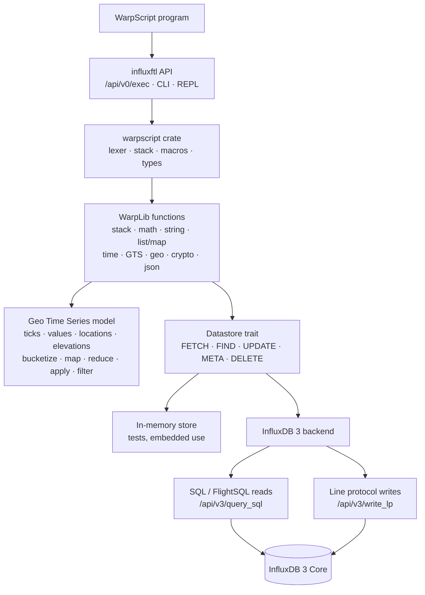

# influxftl — WarpLib / WarpScript for InfluxDB 3

`influxftl` is a Rust port of **WarpLib**, the WarpScript function library of the
[Warp 10 platform](https://github.com/senx/warp10-platform) (Java), running on
[InfluxDB 3 Core](https://github.com/influxdata/influxdb) (Rust).

> **Goal:** any WarpScript program that works on Warp 10 should work, unchanged, against
> data stored in InfluxDB 3.

---

## 1. Motivation and goals

Warp 10 has two halves:

| Warp 10 half        | What it does                                                      | What we do with it                          |
|---------------------|-------------------------------------------------------------------|---------------------------------------------|
| **Storage Engine**  | Ingestion, persistence (LevelDB / FoundationDB), tokens, Datalog… | **Not ported.** InfluxDB 3 Core is the store |
| **Analytics Engine**| WarpScript language + **WarpLib** (1300+ functions)               | **Ported to Rust** — this repository        |

InfluxDB 3 Core already provides the storage half in Rust (write path, WAL, Parquet,
object store, catalog, DataFusion query engine, HTTP API, auth). We port only WarpLib.

### Goals

1. **Port WarpLib to Rust.** Every function in Warp 10's `WarpScriptLib` (1 074 named
   functions, 149 mapper / reducer / bucketizer / filter / op objects, at revision `b576436`)
   is in scope. Status: [`docs/FUNCTIONS.md`](docs/FUNCTIONS.md).
2. **Behavioural compatibility.** Same stack semantics, type coercions, error conditions,
   output formats and time units (microseconds, as in a default Warp 10). Existing programs,
   macros and `WarpFleet`-style libraries run unmodified.
3. **InfluxDB 3 Core is the only datastore.** `FETCH`, `FIND`, `UPDATE`, `META`, `DELETE`
   use SQL for reads and line protocol for writes. Geo Time Series (GTS) map onto
   measurements, tags and fields.
4. **Production-grade engineering from day one** (§5): 100 % coverage of files, lines and
   regions, a dependency audit, lints, formatting, [Kani](https://model-checking.github.io/kani/)
   proofs of critical arithmetic, and reproducible container builds.
5. **Open source, license-compatible with both upstreams** (Apache-2.0, §8).

### Non-goals

- The Warp 10 storage engine, Datalog replication, Plasma streaming, runner, token
  cryptography, HFiles, and the Java plugin or extension loaders.
- A drop-in network replacement of every Warp 10 endpoint. We provide `/api/v0/exec` and a
  CLI; ingestion goes through InfluxDB 3's `/api/v3/write_lp`.
- Java-specific features (`JAVA` extension, Py4J bridge, `PIGSCHEMA`, class-loader `EXT`).
  They exist in the registry and raise a "not supported on this platform" error.

---

## 2. Architecture



### Crates

| Crate                 | Path                 | Role                                                                 |
|-----------------------|----------------------|----------------------------------------------------------------------|
| `warpscript`          | `crates/warpscript`  | The language runtime and WarpLib. **Storage agnostic**, no I/O.      |
| `influxftl`           | `crates/influxftl`   | Binary: CLI / HTTP execution endpoint + InfluxDB 3 datastore backend. |
| `xtask`               | `xtask`              | Developer automation (`cargo xtask …`), see §5.                      |

As in Warp 10, the Analytics Engine works without the Storage Engine: `warpscript` embeds in
any Rust program with a custom `Datastore`.

### Compatibility contract

The reference is Warp 10 at revision `b5764364679f6ccc40a23632e352d134fab1c2eb` (`master`,
2025). Its Java sources are vendored read-only under `reference/` (git-ignored). For every
ported function we keep:

- the **stack signature** (what is consumed and produced, in which order);
- the **type coercion rules** (`LONG`/`DOUBLE` promotion, Java wrapping arithmetic, string
  concatenation with `+`, `NaN` handling);
- the **error messages** where scripts could depend on them (`TRY`/`ERROR`);
- the **textual formats** (`SNAPSHOT`, `->JSON`, `TOSTRING`, GTS text format, ISO 8601).

Known differences are listed in [`docs/DIVERGENCES.md`](docs/DIVERGENCES.md).

### Mapping Warp 10 concepts onto InfluxDB 3

| Warp 10                         | InfluxDB 3 Core                                                        |
|---------------------------------|------------------------------------------------------------------------|
| GTS **class name**              | table (measurement)                                                    |
| GTS **labels**                  | tags (a label cannot be named like a column below)                     |
| **tick** (µs by default)        | `time` column (ns), converted at the datastore boundary                |
| **value** (LONG/DOUBLE/BOOLEAN/STRING) | `value_type` (`l`, `d`, `b`, `s`) and one column `value_l`, `value_d`, `value_b` or `value_s` |
| **location** (HHCode)           | `hhcode` (integer; a marker value when absent)                         |
| **elevation** (mm)              | `elevation` (integer; a marker value when absent)                      |
| GTS **attributes** (mutable metadata) | rows of `_influxftl_series` (tags `class`, `labels`; fields `attributes`, `deleted`); the latest row is current |
| read / write token              | InfluxDB 3 token (`Authorization: Bearer …`)                           |
| `FETCH` selector `class{labels}`| `SELECT … FROM class WHERE tag = … AND time …`; `influxftl` evaluates the selector itself |
| `UPDATE` / GTS input format     | line protocol                                                          |
| `DELETE` of a series            | deletes the table (InfluxDB 3 Core cannot delete datapoints), see `docs/DATASTORE.md` |

---

## 3. Repository layout

```
.
├── Cargo.toml                 # workspace
├── rust-toolchain.toml        # pinned stable toolchain
├── deny.toml                  # cargo-deny policy (licenses, advisories, sources, bans)
├── Dockerfile                 # OCI build, Docker / Podman / Buildah compatible
├── crates/
│   ├── warpscript/            # language runtime + WarpLib (library)
│   └── influxftl/             # CLI / server binary + InfluxDB 3 backend
├── xtask/                     # `cargo xtask` developer automation
├── docs/
│   ├── FUNCTIONS.md           # port status of every WarpLib function
│   ├── DIVERGENCES.md         # documented behavioural differences
│   └── RUST_RULES.md          # coding rules: no unsafe, typed errors, NaN policy
├── reference/                 # git-ignored sparse checkout of Warp 10 (Java)
├── LICENSE                    # Apache-2.0
└── NOTICE                     # attribution
```

---

## 4. Getting started

```sh
# run a script (platform time unit: microseconds, like Warp 10)
cargo run -p influxftl -- run examples/hello.mc2

# evaluate a one-liner and print the stack as JSON, top first
cargo run -p influxftl -- eval "1 2 + 'hello' 3 ->LIST"

# serve the execution endpoint
cargo run -p influxftl -- serve --listen 127.0.0.1:8080
curl --data-binary "40 2 +" http://127.0.0.1:8080/api/v0/exec      # [42]
```

`POST /api/v0/exec` answers the stack as JSON (top first) with `X-Warp10-Elapsed` and
`X-Warp10-Ops`. A failing script gets a `500` with `X-Warp10-Error-Line` and
`X-Warp10-Error-Message`, as in Warp 10. Datastore functions (`FETCH`, `FIND`, `UPDATE`,
`META`, `DELETE`…) use the datastore selected by the environment (`docs/DATASTORE.md`):

```sh
# InfluxDB 3 Core: a database (created by the first write) and, if needed, a token
export INFLUXFTL_DATASTORE=influxdb3 INFLUXDB3_DATABASE_NAME=warp
export INFLUXDB3_HOST_URL=http://127.0.0.1:8181 INFLUXDB3_AUTH_TOKEN=apiv3_…
cargo run -p influxftl -- eval "NEWGTS 'cpu' RENAME { 'host' 'a' } RELABEL 10 NaN NaN NaN 42 ADDVALUE \
  'token' UPDATE [ 'token' 'cpu' { } 100 100 ] FETCH"

# an in-memory datastore, which forgets everything when the process ends
INFLUXFTL_DATASTORE=memory cargo run -p influxftl -- serve
```

Embedding the engine:

```rust
use warpscript::{Stack, Value};

let mut stack = Stack::new();
stack.exec("1 2 +")?;
assert_eq!(stack.peek()?, &Value::Long(3));
# Ok::<(), warpscript::Error>(())
```

---

## 5. Quality gates (`cargo xtask`)

Every gate is driven by the `xtask` crate, so they run the same on a laptop, in the
container and in CI. **There is no git hook**: run the chain yourself before calling work done.

| Command                      | What it does                                                                                 |
|------------------------------|----------------------------------------------------------------------------------------------|
| `cargo xtask security-audit` | `cargo deny check` (licenses, advisories, bans, sources) **and** `cargo audit` (RustSec DB) |
| `cargo xtask check`          | `cargo check --workspace --all-targets --locked`                                             |
| `cargo xtask fmt`            | `cargo fmt --all --check`                                                                    |
| `cargo xtask clippy`         | `cargo clippy --workspace --all-targets -- -D warnings`                                      |
| `cargo xtask test`           | `cargo test --workspace`                                                                     |
| `cargo xtask coverage`       | `cargo llvm-cov`; **fails unless every file is at 100 % lines, regions and functions**       |
| `cargo xtask proof`          | `cargo kani`, running all Kani proof harnesses                                               |
| `cargo xtask dev-check`      | The full pre-push chain: **security-audit → check → fmt → clippy → test → coverage → proof** |
| `cargo xtask functions`      | Regenerates `docs/FUNCTIONS.md` from the registry and the reference inventory                |

### Coverage policy

- Measured with `cargo llvm-cov` (regions, lines, functions).
- Scope: every `.rs` file of `crates/*/src` that defines a function. Files that only declare
  types (such as typed-error enums whose `Display` comes from `thiserror`) have nothing to
  count. Test code lives in dedicated files (`…/tests.rs`, `tests/`) and is excluded, so test
  assertions do not affect the figures. `xtask` is excluded as well.
- Consequences: no unreachable defensive branches, no unexercised `#[derive]`s, every `?`
  error path has a test, and every function has a test. A 1 000+ function port is only
  trustworthy if every path runs.

### Formal proofs (Kani)

Pure, security- or correctness-critical helpers (tick and bucket arithmetic, overflow-free
time conversions, HHCode encoding, varints, percent-decoding, tokenizer invariants) carry
`#[kani::proof]` harnesses. They prove the absence of panics and key algebraic properties for
all inputs within bounds. `cargo xtask proof` runs them all.

### Security audit

`deny.toml` allows only OSI licenses compatible with Apache-2.0 (Apache-2.0, MIT, BSD, ISC,
Unicode, Zlib…), denies yanked crates and known advisories, and restricts sources to
crates.io. `cargo audit` checks `Cargo.lock` against the RustSec database.

---

## 6. Building with Docker / Podman / Buildah

The `Dockerfile` is plain OCI (no BuildKit-only syntax, fully qualified image names):

```sh
docker build -t influxftl .
podman build -t influxftl .
buildah build -t influxftl .
```

Stages:

- `builder`: official `rust` image, `cargo build --release --locked`;
- `dev`: official `rust` image plus `cargo-deny`, `cargo-audit`, `cargo-llvm-cov` and `kani`,
  to run the full `cargo xtask dev-check` anywhere:
  `podman build --target dev -t influxftl-dev . && podman run --rm influxftl-dev`;
- `runtime`: minimal Debian image with the `influxftl` binary. It is the last stage, so it is
  what `podman build` and `buildah build` produce without `--target`.

Verified with Podman 6.1.3 on x86_64 (Manjaro): the default build produces
`localhost/influxftl:test`, which runs as a non-root user and evaluates `[ 1 2 3 ] 2 GET 40 2 +`.
`podman run --rm localhost/influxftl-dev:test` (the `dev` target) runs the full
`cargo xtask dev-check` to the end inside the container: cargo-deny, cargo-audit, check, fmt,
clippy, 1246 tests, the 100 % coverage gate and 12 Kani harnesses, all passing.

Build arguments: `RUST_VERSION` (default from `rust-toolchain.toml`), `DEBIAN_VERSION`.

---

## 7. Development workflow

- Code follows [`docs/RUST_RULES.md`](docs/RUST_RULES.md): no `unsafe`, no `unwrap()` in
  library code, typed `thiserror` errors propagated with `?`, no swallowed errors, NaN and
  Infinity refused at the edges. This is a Rust port, not a transliteration of the Java.
- Work is committed **locally and iteratively**; nothing is pushed automatically. Each commit
  must leave `cargo xtask dev-check` green.
- Launch long runs (`dev-check`, coverage, Kani) detached so that closing the editor does not
  kill them: `setsid nohup cargo xtask dev-check > /tmp/devcheck.log 2>&1 &`.
- To port a function: read the Java source under `reference/`, implement it in the matching
  `crates/warpscript/src/functions/<group>/` module, register it, add script-level tests
  (`assert_script!`) covering every branch, then run `cargo xtask functions`.
- Milestones:
  1. runtime core: lexer, stack, macros, control flow, symbols, errors, limits;
  2. scalar WarpLib: stack, arithmetic, math, strings, lists, maps, sets, JSON, time;
  3. GTS model and frameworks: `BUCKETIZE`, `MAP`, `REDUCE`, `APPLY`, `FILTER`, `FILL`;
  4. mappers, reducers, bucketizers, filters, ops and fillers;
  5. datastore functions on InfluxDB 3: `FETCH`, `FIND`, `UPDATE`, `META`, `DELETE`;
  6. geo (HHCode, GeoXP shapes), encoders, crypto, compression, formats (`SNAPSHOT`, `WRAP`);
  7. HTTP execution endpoint, `TIMEBOX`, limits, capabilities;
  8. the long tail of the registry, until `docs/FUNCTIONS.md` is all green.

---

## 8. License

`influxftl` is licensed under the **Apache License, Version 2.0** — see [`LICENSE`](LICENSE)
and [`NOTICE`](NOTICE).

Apache-2.0 is Warp 10's license, and InfluxDB 3 Core is dual-licensed MIT **or** Apache-2.0.
The project is therefore compatible with both upstreams: Warp 10 code can be ported here, and
this code could be contributed back to either project.

### Licensing of derived code

As an Apache-2.0 derivative work, the repository follows section 4 of the license:

- every source file carries a header naming what it derives from (`// Derived from Warp 10
  (Copyright 2018-2026 SenX S.A.S., Apache-2.0), ported to Rust and modified.`), which is the
  "prominent notice of modification";
- [`NOTICE`](NOTICE) reproduces the attribution of the upstream `NOTICE` files that apply and
  the full notices of the permissively licensed works;
- original copyright notices are kept in those headers and in `NOTICE`.

| Work | License | Use in `influxftl` |
|---|---|---|
| [Warp 10](https://github.com/senx/warp10-platform) (SenX S.A.S.) | Apache-2.0 | WarpLib ported to Rust: names, semantics, algorithms, error messages |
| [GeoXP](https://github.com/senx/geoxplib) (SenX S.A.S.) | Apache-2.0 | HHCode geo-indexing scheme |
| [InfluxDB 3 Core](https://github.com/influxdata/influxdb) (InfluxData) | MIT or Apache-2.0 | **Runtime dependency only**: no InfluxDB source is included; it is used through its HTTP API |
| [mustache.java 0.9.6](https://github.com/spullara/mustache.java) (RightTime, Inc.) | Apache-2.0 | `TEMPLATE` (template compiler and renderer) |
| [Apache Commons Math 3.6.1](https://commons.apache.org/math/) (ASF) | Apache-2.0 | numerical routines of `cmath.rs`, interpolators of `interpolation.rs`, Levenberg-Marquardt fitting of `curvefit.rs` |
| [Bouncy Castle](https://www.bouncycastle.org) (Legion of the Bouncy Castle) | MIT-style | Argon2 engine of `ARGON2`; OpenPGP packet and signature code of `openpgp/` |
| [fdlibm](https://www.netlib.org/fdlibm/) (Sun Microsystems) | permissive Sun notice | `IEEEREMAINDER` algorithm |
| [Noto Sans, Noto Serif, Noto Sans Mono](https://github.com/notofonts/latin-greek-cyrillic) (The Noto Project Authors) | SIL OFL 1.1 | advance widths of the typography functions (`processing/font_advances.rs`; DIVERGENCES §44) |
| [Processing](https://github.com/processing/processing4) core library (Processing Foundation) | LGPL-2.1 | **Not used as a dependency.** The `P*` functions, the typography functions included, follow the observation-only rule of `docs/PORTING.md` §9; their glyphs are the port's own bitmaps (DIVERGENCES §44) |

Java behaviour that scripts can observe (`java.lang.Math`, `java.util.Random`,
`java.util.Formatter`, `Double.toString`, Joda-Time, Jackson, Guava…) is **re-implemented from
public specifications and validated black-box against the JDK**. OpenJDK is GPLv2 with the
Classpath exception, which is not compatible with redistribution under Apache-2.0, so no
OpenJDK code is transliterated. `docs/PORTING.md` §8 states these rules for contributors.

Dependencies are policed by `deny.toml`: only OSI licenses compatible with Apache-2.0 are
allowed (`cargo deny check licenses` is part of `cargo xtask dev-check`).

### Trademarks

*Warp 10, WarpScript, WarpLib, WarpFleet, Geo Time Series and SenX* are trademarks of SenX
S.A.S.; *InfluxDB* and *InfluxData* are trademarks of InfluxData, Inc. They are used only to
describe what this software is compatible with or runs on (nominative use). This project is
**not** endorsed by, affiliated with or supported by SenX or InfluxData.

---

## 9. Acknowledgements and credits

- **[Warp 10](https://warp10.io) by [SenX S.A.S.](https://senx.io)**: the WarpScript language,
  the WarpLib function library and the Geo Time Series model were designed by the SenX team and
  the Warp 10 community. `influxftl` ports that work; the function names, semantics,
  documentation, error messages and most algorithms are theirs. Warp 10 is released under
  Apache-2.0 (<https://github.com/senx/warp10-platform>, Copyright 2018-2026 SenX S.A.S.).
- **[InfluxDB 3 Core](https://github.com/influxdata/influxdb) by
  [InfluxData, Inc.](https://www.influxdata.com)**: the storage engine, query engine (Apache
  DataFusion and Arrow), write path and HTTP API this project runs on. Copyright (c) 2020
  InfluxData, dual-licensed MIT / Apache-2.0.
- **[mustache.java](https://github.com/spullara/mustache.java)** (Sam Pullara, RightTime,
  Inc., Apache-2.0): its compiler is ported for `TEMPLATE`.
- **[Apache Commons Math](https://commons.apache.org/math/)** (The Apache Software Foundation,
  Apache-2.0): numerical routines in `cmath.rs`, interpolators in `interpolation.rs`, and
  Levenberg-Marquardt fitting in `curvefit.rs`.
- **[The Legion of the Bouncy Castle](https://www.bouncycastle.org)** (MIT-style): the Argon2
  implementation ported for `ARGON2`, and the OpenPGP behaviour reproduced in `openpgp/`.
- **fdlibm** (Sun Microsystems): the IEEE remainder algorithm.
- **[Pyrolite](https://github.com/irmen/pickle)** (Irmen de Jong, MIT): the pickle serializer
  and deserializer ported for `->PICKLE` and `PICKLE->`.
- **[GeoXP](https://github.com/senx/geoxplib)** (SenX, Apache-2.0): the HHCode geo-indexing
  scheme used by the geo functions.
- **Joda-Time** (Joda.org), the **Jackson JSON processor** (Tatu Saloranta and contributors)
  and **Google Guava**, whose documented behaviour is reproduced so that dates, JSON and
  encodings match Warp 10.
- The **Rust ecosystem**: Apache Arrow and DataFusion, the RustCrypto hashes, `chrono`,
  `fancy-regex`, `cargo-llvm-cov`, `cargo-deny`, `cargo-audit` (RustSec) and the **Kani** model
  checker (AWS), which make this repository's quality gates possible.

Thank you.
